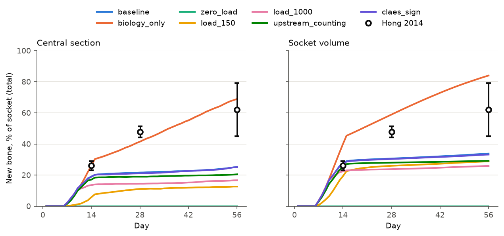

# Hong 2014 calibration, milestone 1: the empty socket

Stage 1 of the dental plan ([../DESIGN.md](../DESIGN.md)) calibrates SG-Bone on Hong et al. 2014, beagle P3 root sockets left empty or grafted with β-TCP. Milestone 1 builds the socket model and runs the **empty-socket arm** end to end against Hong. Nothing is fitted yet, and the β-TCP arm has not been started. The model itself is described in [../README.md](../README.md).

## Target: Hong et al. 2014
Clin Oral Implants Res, doi:10.1111/clr.12041. Eight beagles; P3 in all four quadrants was sectioned into mesial and distal roots and extracted. Each root socket was randomly left empty or filled to the crest with HA, β-TCP (Cerasorb, 500-1000 µm) or BCP. The flap was coronally advanced and closed, and the dogs ate soft food for 2 weeks. Two dogs were killed at 2 weeks, two at 4 and four at 8 weeks. On the most central mesio-distal H&E section, the socket (below the line joining the mesial and distal crests) was split into apical, middle and coronal thirds of equal height, and new bone (NB), residual biomaterial (RB) and fibrovascular connective tissue (FCT) were measured as % of socket area.

Empty sockets, % new bone ([data/hong2014_empty_socket.csv](data/hong2014_empty_socket.csv)):

| | Week 2 | Week 4 | Week 8 |
|---|---|---|---|
| Total (text, mean ± SD) | 26.0 ± 2.9 | 47.7 ± 3.6 | 62.0 ± 17.1 |
| Apical / middle / coronal (Fig. 8, digitized) | 37.0 / 27.7 / 19.6 | 46.6 / 46.8 / 49.0 | 61.6 / 60.5 / 62.5 |

- FCT is 100 − NB in empty sockets (Fig. 7 bars reach 100 %).
- **Not available:** standard deviations per third (they are in the online Table S1, which we do not have), separate values for mesial and distal roots or for maxilla and mandible (pooled in the paper), and any socket dimensions. The thirds come from pixel heights of Fig. 8 at 400 dpi, accurate to about ±1 percentage point. The digitized β-TCP values for the next milestone are in [data/hong2014_btcp.csv](data/hong2014_btcp.csv).
- Histology: at 2 weeks woven bone grows from the socket wall all around except in the mid-to-coronal area. At 4 weeks woven bone fills the socket up to the entrance. At 8 weeks the socket holds new bone and marrow, under a periosteum-like tissue at the entrance. No cartilage is mentioned.

## Cases
All runs use the same mesh (0.8 mm socket elements) and the same day-0 seeding. Seeds change only the cell dynamics.

| Case | What changes | Why |
|---|---|---|
| `baseline` (seeds 1, 2, 3) | far-field strain 300 µε | assumed low physiological load; see [../README.md](../README.md#mechanics) |
| `zero_load` | 0 µε | biology without mechanics, with the validated rules |
| `load_150`, `load_1000` | 150 and 1000 µε | load sensitivity |
| `biology_only` (seeds 1, 2, 3) | bone stimulus forced in every element | what the cell kinetics alone give |
| `upstream_counting` | upstream integer truncation of per-element counts | effect of the stochastic rounding |
| `claes_sign` | Claes-Heigele sign for cartilage (compression) | sign convention |
| `mesh06_*` | 0.6 mm socket elements (1 139 instead of 521) | mesh sensitivity |
| `rerun_baseline_s1` | none | reproducibility |

## Results
The model's NB is the share of socket lattice points that hold osteoblasts. FCT is everything else except cartilage (fibroblasts, MSCs and empty clot points). "Section" is the lattice plane through the socket axis (y = 0), as Hong measured; "volume" is the whole socket. Day d is the lattice after d daily iterations. ± is the SD over three seeds.

**New bone, % of socket**

| Day | Third | Hong 2014 | Baseline 300 µε, section | Baseline, volume | Biology-only, section | Biology-only, volume |
|---|---|---|---|---|---|---|
| 14 | apical | 37.0 | 25.1 ± 2.2 | 32.0 ± 0.2 | 39.4 ± 0.4 | 55.7 ± 0.2 |
| 14 | middle | 27.7 | 22.7 ± 0.8 | 29.9 ± 0.3 | 24.8 ± 1.8 | 41.9 ± 0.3 |
| 14 | coronal | 19.6 | 12.7 ± 0.8 | 24.2 ± 0.4 | 20.0 ± 0.8 | 34.1 ± 0.1 |
| 14 | **total** | 26.0 ± 2.9 | 19.0 ± 0.4 | 27.3 ± 0.2 | 26.1 ± 0.6 | 40.0 ± 0.1 |
| 28 | apical | 46.6 | 25.8 ± 2.6 | 32.4 ± 0.4 | 58.1 ± 0.9 | 76.6 ± 0.1 |
| 28 | middle | 46.8 | 27.1 ± 0.5 | 32.9 ± 0.3 | 41.0 ± 1.5 | 61.9 ± 0.1 |
| 28 | coronal | 49.0 | 14.8 ± 0.9 | 28.6 ± 0.5 | 32.8 ± 1.8 | 51.7 ± 0.1 |
| 28 | **total** | 47.7 ± 3.6 | 21.6 ± 0.3 | 30.6 ± 0.2 | 41.5 ± 0.4 | 58.9 ± 0.1 |
| 56 | apical | 61.6 | 25.8 ± 2.6 | 32.4 ± 0.4 | 86.6 ± 0.5 | 94.6 ± 0.1 |
| 56 | middle | 60.5 | 28.1 ± 0.8 | 33.1 ± 0.3 | 71.3 ± 1.8 | 87.7 ± 0.3 |
| 56 | coronal | 62.5 | 22.2 ± 1.5 | 34.7 ± 0.7 | 57.3 ± 1.1 | 78.4 ± 0.1 |
| 56 | **total** | 62.0 ± 17.1 | 25.1 ± 0.3 | 33.8 ± 0.3 | 68.9 ± 0.2 | 84.0 ± 0.1 |

FCT on the section, total: baseline 79.5 / 74.8 / 71.2 %, biology-only 73.9 / 58.5 / 31.1 %, Hong 74.0 / 52.3 / 38.0 % (days 14 / 28 / 56). Cartilage per third and the FCT breakdown are in [results/m1/analysis/comparison.md](results/m1/analysis/comparison.md) and `summary.csv`.

**All cases, totals** (seed 1 unless noted)

| Case | NB section, d14 / d28 / d56 | NB volume, d14 / d28 / d56 | Cartilage section, d14 / d28 / d56 |
|---|---|---|---|
| No load | 0.0 / 0.0 / 0.0 | 0.0 / 0.0 / 0.0 | 0.0 / 0.0 / 0.0 |
| 150 µε | 5.7 / 11.1 / 12.6 | 19.3 / 25.9 / 28.8 | 0.0 / 0.1 / 0.1 |
| 300 µε (baseline, 3 seeds) | 19.0 / 21.6 / 25.1 | 27.3 / 30.6 / 33.8 | 1.4 / 3.6 / 3.6 |
| 1000 µε | 13.6 / 14.4 / 16.6 | 22.4 / 23.8 / 25.9 | 5.0 / 7.6 / 12.9 |
| 300 µε, upstream integer counting | 17.1 / 18.9 / 20.5 | 25.2 / 27.9 / 29.1 | 1.3 / 2.5 / 3.5 |
| 300 µε, Claes-Heigele sign | 18.9 / 21.1 / 25.1 | 27.1 / 30.3 / 33.2 | 4.0 / 12.0 / 30.9 |
| 300 µε, 0.6 mm socket mesh | 15.7 / 18.0 / 26.0 | 26.5 / 30.2 / 35.6 | 4.8 / 9.2 / 4.3 |
| Biology-only (3 seeds) | 26.1 / 41.5 / 68.9 | 40.0 / 58.9 / 84.0 | 0.0 / 0.0 / 0.0 |
| Biology-only, 0.6 mm socket mesh | 25.8 / 39.9 / 68.3 | 39.3 / 58.1 / 83.3 | 0.0 / 0.0 / 0.0 |
| Hong 2014 | 26.0 / 47.7 / 62.0 | (section only) | none reported |


*Total new bone on the central section and in the socket volume. The baseline and Claes-sign curves lie on top of each other.*


## What the runs show
1. **With the validated mechanoregulation the socket stops ossifying after two weeks.** At 300 µε the clot sees |ε_min| ≈ 730-860 µε at day 0 (the far-field strain amplified about 2.6 times), so every element starts with the bone stimulus. Bone grows from the walls and reaches 19 % of the section (27 % of the volume) by day 14, against Hong's 26 %. Then it stalls at 22-25 %, while Hong goes to 48 % and 62 %. The cause is mechanical. An element that holds some bone is stiff (rule of mixtures with 17 GPa bone), so under the imposed strain its hydrostatic pressure exceeds 0.15 MPa and the element switches to the fibrous stimulus (median |HP| 0.2 MPa at day 14, 0.6 MPa from day 28). By day 56, 454 of 521 elements are fibrous; the strain stays small (median |ε_min| ≈ 460 µε). New MSCs then become fibroblasts, and osteoblasts only proliferate in elements that still have the bone stimulus. The 15-day drop in cell activity slows things further.
2. **No load level fixes this.** With no load every element is in the resorption window (|HP| < 0.0016 MPa, |ε_min| < 400 µε): no cell differentiates and the socket fills with MSCs. At 150 µε the day-0 strain sits on the 400 µε threshold (median 390 µε), so three quarters of the elements start without differentiation and the section reaches only 13 % bone. At 1000 µε elements switch to fibrous sooner, the section reaches 17 %, and cartilage appears coronally (13 % at day 56, from tension under the original sign). The window closes from both sides.
3. **The cell kinetics alone give about the right pace.** With the bone stimulus forced everywhere, the section total is 26 / 42 / 69 % against 26 / 48 / 62 %, without any fitting. At day 14 the thirds also match (39 / 25 / 20 vs 37 / 28 / 20). Two things differ:
   - The model keeps its apical-to-coronal gradient (58 / 41 / 33 at day 28), whereas in Hong it is gone by week 4 (47 / 47 / 49). MSCs migrate only along non-MSC surfaces, so the clot in the middle and coronal centre fills only by proliferation (see the open column in the section maps).
   - At 8 weeks the apical third overshoots (87 vs 62 %). The model has no marrow formation or woven-bone remodelling, while Hong's 8-week sockets hold new bone and marrow.
4. **Sign convention:** bone is the same with both signs. With the Claes-Heigele sign, the elements under compressive HP become cartilage (31 % of the section at day 56). Hong reports FCT and no cartilage, so the original sign fits the histology better here.
5. **Section vs volume:** the volume always has 8-17 points more bone than the central section, because more of the volume lies near the wall. Hong measured sections, so the section is the comparable number.
6. **Counting:** the upstream integer truncation lowers bone by 2-5 points at 300 µε. With about 85 lattice points per element, the post-day-15 rates are partly switched off by truncation.
7. **Mesh and seeds:** the biology-only result does not depend on the mesh (0.6 vs 0.8 mm: within 1.5 points). The mechanically coupled baseline moves by up to 4 points on the section, and its cartilage is two to three times higher at days 14-28 (still under 10 %), but the plateau stays. The SD of NB over three seeds is 0.2-2.6 points, small next to the gaps to Hong.
8. **Reproducibility:** a rerun with the same seed is bit-identical (statistics and the day-56 lattice). The same seed with CalculiX 2.17 (laptop) and 2.21 (pool) gives identical daily statistics. CalculiX runs on one thread (`run.sh`).

## Decisions needed before fitting and the β-TCP arm
1. **Mechanoregulation in the socket (the main one).** As implemented, the 0.15 MPa pressure limit applied to element averages caps the socket at about 25 % bone under any load that keeps the clot out of the resorption window. The long-bone model has the same rule; in the socket it shows because 60 % of a strained cavity has to ossify. Options:
   - evaluate the stimulus in the soft-tissue phase only (for example element strain × granulation-tissue modulus), or stop re-classifying elements once they are mostly bone;
   - use a strain-based rule (Claes-Heigele strain limits only, or Prendergast's shear strain);
   - drop the resorption (no-differentiation) window in the socket, so that an unloaded socket heals by biology;
   - calibrate the empty socket on the biology-only setting and keep mechanics for the implant stage.

   Any of these makes the dental model diverge from the validated long-bone model.
2. **Load:** magnitude and direction of the far-field strain. No dog value for a soft diet was found; macaque corpus strains during chewing are about 50-200 µε. Under the current rules the result is very sensitive to it (item 2 above).
3. **Calibration target and weights:** the central section (as Hong) with totals as the primary target (they have SDs; n = 2 dogs at 2 and 4 weeks), and the digitized thirds (no SD) as secondary.
4. **What may be fitted:** the cell rates, the 15-day high-activity period and the /5 drop (the literature review recommends no latency for small sockets), the wall-lining seeding (30 %, 0.2 mm), and whether to add a coronal cell source (the periosteum-like tissue Hong saw at 8 weeks) or let MSCs enter the clot without a guiding surface. The gradient and the 8-week overshoot point at cell entry into the clot and at missing remodelling/marrow, not at the rates.
5. **Stochastic rounding:** keep it as the dental default? It makes the cell rates independent of element size (verified for biology-only) and changes the baseline by 2-5 points.
6. **Geometry:** one generic root (3.6 mm, circular) or separate mesial (3.9 × 4.25 mm) and distal (3.2 mm) P3 roots; the neighbouring root socket; the assumed lingual wall (1.5 mm).
7. **For the β-TCP arm:**
   - Which Cerasorb variant Hong used. The literature review found that a residual graft of 38 % at 2 weeks needs the dense variant (solid fraction about 0.42) or a granule-envelope measurement.
   - How granules enter the lattice. The upstream `scaffold_presence` branch marks scaffold points with lattice code 12. They are a separate FE part (callus elements numbered after the scaffold's) and a guiding surface for migration and differentiation, and they are never resorbed. Its "stimulation by TCP" divides the cell activity by 2 instead of 5 after day 15 (proliferation 0.3 / 0.275 / 0.1 / 0.15, differentiation 0.15). It uses linear tets with one integration point and 35 stiffness bins.
   - The resorption rate (k = 0.031 /day from Hong) and whether β-TCP slows early bone formation, as Hong saw at 2-4 weeks.

## Reproduce
On a Linux machine with CalculiX, gmsh, meshio, numpy, matplotlib and g++ (the runs here used hwpool lease 56ea on phoenix: Ubuntu, ccx 2.21 from apt, gmsh 4.15.2 from pip):

```bash
cd dental
python3 geometry/socket_geometry.py --out ~/sg/meshes/m08
python3 geometry/socket_geometry.py --socket-size 0.6 --out ~/sg/meshes/m06
tools/run_hong_m1.sh ~/sg/meshes/m08 ~/sg/runs_m1                       # 11 runs in parallel
tools/run_hong_m1_checks.sh ~/sg/meshes/m08 ~/sg/meshes/m06 ~/sg/runs_m1_checks
R=~/sg/runs_m1
python3 tools/analyze_socket.py --out ~/sg/ana_m1 --hong hong/data/hong2014_empty_socket.csv \
  --case baseline=$R/baseline_s1,$R/baseline_s2,$R/baseline_s3 \
  --case biology_only=$R/biology_only_s1,$R/biology_only_s2,$R/biology_only_s3 \
  --case zero_load=$R/zero_load --case load_150=$R/load_150 --case load_1000=$R/load_1000 \
  --case upstream_counting=$R/upstream_counting --case claes_sign=$R/claes_sign \
  --maps baseline --maps biology_only --maps claes_sign
```

Run times on phoenix (16 threads, one CalculiX thread per run): meshing under a second; one 56-day run 26 s and 120 MB (0.8 mm mesh) or 38 s and 160 MB (0.6 mm); the 11-run batch about 2 minutes including compilation. Times per run are in `results/m1/timing*.csv`.

## Files
- `data/`: Hong 2014 reference values (empty and β-TCP).
- `results/m1/analysis/`: `summary.csv` (case means and SDs at days 14 / 28 / 56), `daily.csv` (every run, day, region and third), `comparison.md` (tables for every case), figures.
- `results/m1/analysis_mesh_check/`: the 0.6 vs 0.8 mm comparison.
- `results/m1/runs/<case>/`: per-run `statistics.csv`, `mechanics.csv`, upstream counters, `build_info.txt`, `log.txt`, `time.txt`.
- `results/m1/mesh/`: mesh summaries and `model_info.h` of both meshes.

The daily lattices (`lattice_<it>.raw`, 170 kB each) were not kept: every run can be reproduced bit-identically from its seed and flags.
