# Hong 2014 calibration: the empty socket

**Status (2026-11-16):** three milestones are done.
- Milestone 1: model built, no fitting.
- Milestone 2: empty socket calibrated, soft-tissue stimulus checked.
- Milestone 3: β-TCP arm calibrated.

Milestone 1 follows first, then [Milestone 2](#milestone-2-calibration-on-the-empty-socket) and [Milestone 3](#milestone-3-the-β-tcp-arm).


Stage 1 of the dental plan ([../DESIGN.md](../DESIGN.md)) calibrates SG-Bone on Hong et al. 2014, beagle P3 root sockets left empty or grafted with β-TCP. Milestone 1 built the socket model and ran the **empty-socket arm** end to end against Hong, without fitting. The model itself is described in [../README.md](../README.md).

## Target: Hong et al. 2014
Clin Oral Implants Res, doi:10.1111/clr.12041. Eight beagles; P3 in all four quadrants was sectioned into mesial and distal roots and extracted. Each root socket was randomly left empty or filled to the crest with HA, β-TCP (Cerasorb, 500-1000 µm) or BCP. The flap was coronally advanced and closed, and the dogs ate soft food for 2 weeks. Two dogs were killed at 2 weeks, two at 4 and four at 8 weeks. On the most central mesio-distal H&E section, the socket (below the line joining the mesial and distal crests) was split into apical, middle and coronal thirds of equal height, and new bone (NB), residual biomaterial (RB) and fibrovascular connective tissue (FCT) were measured as % of socket area.

Empty sockets, % new bone ([data/hong2014_empty_socket.csv](data/hong2014_empty_socket.csv)):

| | Week 2 | Week 4 | Week 8 |
|---|---|---|---|
| Total (text, mean ± SD) | 26.0 ± 2.9 | 47.7 ± 3.6 | 62.0 ± 17.1 |
| Apical / middle / coronal (Fig. 8, digitized) | 37.0 / 27.7 / 19.6 | 46.6 / 46.8 / 49.0 | 61.6 / 60.5 / 62.5 |

- FCT is 100 − NB in empty sockets (Fig. 7 bars reach 100 %).
- **Not available:** standard deviations per third (they are in the online Table S1, which we do not have), separate values for mesial and distal roots or for maxilla and mandible (pooled in the paper), and any socket dimensions. The thirds come from pixel heights of Fig. 8 at 400 dpi, accurate to about ±1 percentage point. The digitized β-TCP values for the next milestone are in [data/hong2014_btcp.csv](data/hong2014_btcp.csv).
- Histology: at 2 weeks woven bone grows from the socket wall all around except in the mid-to-coronal area. At 4 weeks woven bone fills the socket up to the entrance. At 8 weeks the socket holds new bone and marrow, under a periosteum-like tissue at the entrance. No cartilage is mentioned.

## Cases
All runs use the same mesh (0.8 mm socket elements) and the same day-0 seeding. Seeds change only the cell dynamics.

| Case | What changes | Why |
|---|---|---|
| `baseline` (seeds 1, 2, 3) | far-field strain 300 µε | assumed low physiological load; see [../README.md](../README.md#mechanics) |
| `zero_load` | 0 µε | biology without mechanics, with the validated rules |
| `load_150`, `load_1000` | 150 and 1000 µε | load sensitivity |
| `biology_only` (seeds 1, 2, 3) | bone stimulus forced in every element | what the cell kinetics alone give |
| `upstream_counting` | upstream integer truncation of per-element counts | effect of the stochastic rounding |
| `claes_sign` | Claes-Heigele sign for cartilage (compression) | sign convention |
| `mesh06_*` | 0.6 mm socket elements (1 139 instead of 521) | mesh sensitivity |
| `rerun_baseline_s1` | none | reproducibility |

## Results
The model's NB is the share of socket lattice points that hold osteoblasts. FCT is everything else except cartilage (fibroblasts, MSCs and empty clot points). "Section" is the lattice plane through the socket axis (y = 0), as Hong measured; "volume" is the whole socket. Day d is the lattice after d daily iterations. ± is the SD over three seeds.

**New bone, % of socket**

| Day | Third | Hong 2014 | Baseline 300 µε, section | Baseline, volume | Biology-only, section | Biology-only, volume |
|---|---|---|---|---|---|---|
| 14 | apical | 37.0 | 25.1 ± 2.2 | 32.0 ± 0.2 | 39.4 ± 0.4 | 55.7 ± 0.2 |
| 14 | middle | 27.7 | 22.7 ± 0.8 | 29.9 ± 0.3 | 24.8 ± 1.8 | 41.9 ± 0.3 |
| 14 | coronal | 19.6 | 12.7 ± 0.8 | 24.2 ± 0.4 | 20.0 ± 0.8 | 34.1 ± 0.1 |
| 14 | **total** | 26.0 ± 2.9 | 19.0 ± 0.4 | 27.3 ± 0.2 | 26.1 ± 0.6 | 40.0 ± 0.1 |
| 28 | apical | 46.6 | 25.8 ± 2.6 | 32.4 ± 0.4 | 58.1 ± 0.9 | 76.6 ± 0.1 |
| 28 | middle | 46.8 | 27.1 ± 0.5 | 32.9 ± 0.3 | 41.0 ± 1.5 | 61.9 ± 0.1 |
| 28 | coronal | 49.0 | 14.8 ± 0.9 | 28.6 ± 0.5 | 32.8 ± 1.8 | 51.7 ± 0.1 |
| 28 | **total** | 47.7 ± 3.6 | 21.6 ± 0.3 | 30.6 ± 0.2 | 41.5 ± 0.4 | 58.9 ± 0.1 |
| 56 | apical | 61.6 | 25.8 ± 2.6 | 32.4 ± 0.4 | 86.6 ± 0.5 | 94.6 ± 0.1 |
| 56 | middle | 60.5 | 28.1 ± 0.8 | 33.1 ± 0.3 | 71.3 ± 1.8 | 87.7 ± 0.3 |
| 56 | coronal | 62.5 | 22.2 ± 1.5 | 34.7 ± 0.7 | 57.3 ± 1.1 | 78.4 ± 0.1 |
| 56 | **total** | 62.0 ± 17.1 | 25.1 ± 0.3 | 33.8 ± 0.3 | 68.9 ± 0.2 | 84.0 ± 0.1 |

FCT on the section, total: baseline 79.5 / 74.8 / 71.2 %, biology-only 73.9 / 58.5 / 31.1 %, Hong 74.0 / 52.3 / 38.0 % (days 14 / 28 / 56). Cartilage per third and the FCT breakdown are in [results/m1/analysis/comparison.md](results/m1/analysis/comparison.md) and `summary.csv`.

**All cases, totals** (seed 1 unless noted)

| Case | NB section, d14 / d28 / d56 | NB volume, d14 / d28 / d56 | Cartilage section, d14 / d28 / d56 |
|---|---|---|---|
| No load | 0.0 / 0.0 / 0.0 | 0.0 / 0.0 / 0.0 | 0.0 / 0.0 / 0.0 |
| 150 µε | 5.7 / 11.1 / 12.6 | 19.3 / 25.9 / 28.8 | 0.0 / 0.1 / 0.1 |
| 300 µε (baseline, 3 seeds) | 19.0 / 21.6 / 25.1 | 27.3 / 30.6 / 33.8 | 1.4 / 3.6 / 3.6 |
| 1000 µε | 13.6 / 14.4 / 16.6 | 22.4 / 23.8 / 25.9 | 5.0 / 7.6 / 12.9 |
| 300 µε, upstream integer counting | 17.1 / 18.9 / 20.5 | 25.2 / 27.9 / 29.1 | 1.3 / 2.5 / 3.5 |
| 300 µε, Claes-Heigele sign | 18.9 / 21.1 / 25.1 | 27.1 / 30.3 / 33.2 | 4.0 / 12.0 / 30.9 |
| 300 µε, 0.6 mm socket mesh | 15.7 / 18.0 / 26.0 | 26.5 / 30.2 / 35.6 | 4.8 / 9.2 / 4.3 |
| Biology-only (3 seeds) | 26.1 / 41.5 / 68.9 | 40.0 / 58.9 / 84.0 | 0.0 / 0.0 / 0.0 |
| Biology-only, 0.6 mm socket mesh | 25.8 / 39.9 / 68.3 | 39.3 / 58.1 / 83.3 | 0.0 / 0.0 / 0.0 |
| Hong 2014 | 26.0 / 47.7 / 62.0 | (section only) | none reported |


*Total new bone on the central section and in the socket volume. The baseline and Claes-sign curves lie on top of each other.*

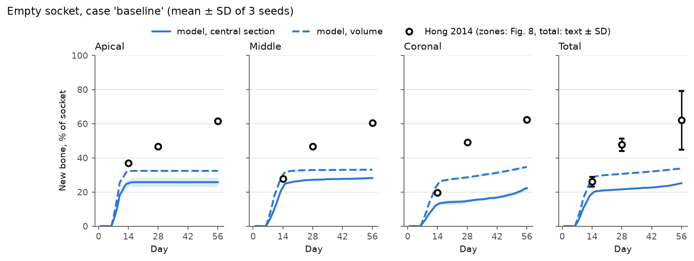
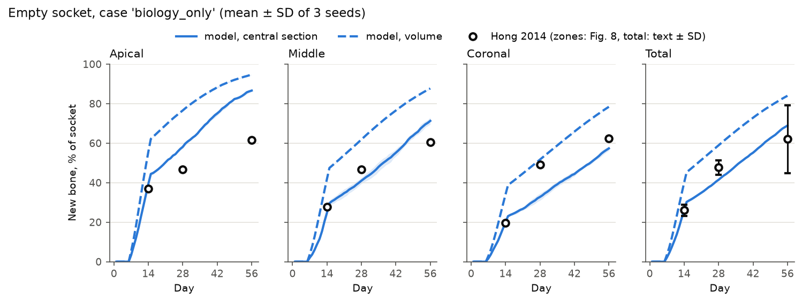
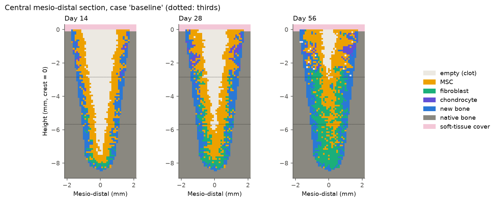
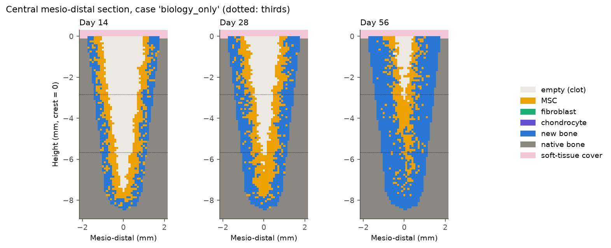

## What the runs show
1. **With the validated mechanoregulation the socket stops ossifying after two weeks.** At 300 µε the clot sees |ε_min| ≈ 730-860 µε at day 0 (the far-field strain amplified about 2.6 times), so every element starts with the bone stimulus. Bone grows from the walls and reaches 19 % of the section (27 % of the volume) by day 14, against Hong's 26 %. Then it stalls at 22-25 %, while Hong goes to 48 % and 62 %. The cause is mechanical. An element that holds some bone is stiff (rule of mixtures with 17 GPa bone), so under the imposed strain its hydrostatic pressure exceeds 0.15 MPa and the element switches to the fibrous stimulus (median |HP| 0.2 MPa at day 14, 0.6 MPa from day 28). By day 56, 454 of 521 elements are fibrous; the strain stays small (median |ε_min| ≈ 460 µε). New MSCs then become fibroblasts, and osteoblasts only proliferate in elements that still have the bone stimulus. The 15-day drop in cell activity slows things further.
2. **No load level fixes this.** With no load every element is in the resorption window (|HP| < 0.0016 MPa, |ε_min| < 400 µε): no cell differentiates and the socket fills with MSCs. At 150 µε the day-0 strain sits on the 400 µε threshold (median 390 µε), so three quarters of the elements start without differentiation and the section reaches only 13 % bone. At 1000 µε elements switch to fibrous sooner, the section reaches 17 %, and cartilage appears coronally (13 % at day 56, from tension under the original sign). The window closes from both sides.
3. **The cell kinetics alone give about the right pace.** With the bone stimulus forced everywhere, the section total is 26 / 42 / 69 % against 26 / 48 / 62 %, without any fitting. At day 14 the thirds also match (39 / 25 / 20 vs 37 / 28 / 20). Two things differ:
   - The model keeps its apical-to-coronal gradient (58 / 41 / 33 at day 28), whereas in Hong it is gone by week 4 (47 / 47 / 49). MSCs migrate only along non-MSC surfaces, so the clot in the middle and coronal centre fills only by proliferation (see the open column in the section maps).
   - At 8 weeks the apical third overshoots (87 vs 62 %). The model has no marrow formation or woven-bone remodelling, while Hong's 8-week sockets hold new bone and marrow.
4. **Sign convention:** bone is the same with both signs. With the Claes-Heigele sign, the elements under compressive HP become cartilage (31 % of the section at day 56). Hong reports FCT and no cartilage, so the original sign fits the histology better here.
5. **Section vs volume:** the volume always has 8-17 points more bone than the central section, because more of the volume lies near the wall. Hong measured sections, so the section is the comparable number.
6. **Counting:** the upstream integer truncation lowers bone by 2-5 points at 300 µε. With about 85 lattice points per element, the post-day-15 rates are partly switched off by truncation.
7. **Mesh and seeds:** the biology-only result does not depend on the mesh (0.6 vs 0.8 mm: within 1.5 points). The mechanically coupled baseline moves by up to 4 points on the section, and its cartilage is two to three times higher at days 14-28 (still under 10 %), but the plateau stays. The SD of NB over three seeds is 0.2-2.6 points, small next to the gaps to Hong.
8. **Reproducibility:** a rerun with the same seed is bit-identical (statistics and the day-56 lattice). The same seed with CalculiX 2.17 (laptop) and 2.21 (pool) gives identical daily statistics. CalculiX runs on one thread (`run.sh`).

## Decisions needed before fitting and the β-TCP arm
*Melih's answers (2026-11-16): fit in the biology-only setting first, then implement and check the soft-tissue-phase stimulus; the dental model may depart from the long-bone rules; central section totals with SDs primary, thirds secondary; one generic root; keep stochastic rounding; few free parameters, report identifiability. See milestone 2.*

1. **Mechanoregulation in the socket (the main one).** As implemented, the 0.15 MPa pressure limit applied to element averages caps the socket at about 25 % bone under any load that keeps the clot out of the resorption window. The long-bone model has the same rule; in the socket it shows because 60 % of a strained cavity has to ossify. Options:
   - evaluate the stimulus in the soft-tissue phase only (for example element strain × granulation-tissue modulus), or stop re-classifying elements once they are mostly bone;
   - use a strain-based rule (Claes-Heigele strain limits only, or Prendergast's shear strain);
   - drop the resorption (no-differentiation) window in the socket, so that an unloaded socket heals by biology;
   - calibrate the empty socket on the biology-only setting and keep mechanics for the implant stage.

   Any of these makes the dental model diverge from the validated long-bone model.
2. **Load:** magnitude and direction of the far-field strain. No dog value for a soft diet was found; macaque corpus strains during chewing are about 50-200 µε. Under the current rules the result is very sensitive to it (item 2 above).
3. **Calibration target and weights:** the central section (as Hong) with totals as the primary target (they have SDs; n = 2 dogs at 2 and 4 weeks), and the digitized thirds (no SD) as secondary.
4. **What may be fitted:** the cell rates, the 15-day high-activity period and the /5 drop (the literature review recommends no latency for small sockets), the wall-lining seeding (30 %, 0.2 mm), and whether to add a coronal cell source (the periosteum-like tissue Hong saw at 8 weeks) or let MSCs enter the clot without a guiding surface. The gradient and the 8-week overshoot point at cell entry into the clot and at missing remodelling/marrow, not at the rates.
5. **Stochastic rounding:** keep it as the dental default? It makes the cell rates independent of element size (verified for biology-only) and changes the baseline by 2-5 points.
6. **Geometry:** one generic root (3.6 mm, circular) or separate mesial (3.9 × 4.25 mm) and distal (3.2 mm) P3 roots; the neighbouring root socket; the assumed lingual wall (1.5 mm).
7. **For the β-TCP arm:**
   - Which Cerasorb variant Hong used. The literature review found that a residual graft of 38 % at 2 weeks needs the dense variant (solid fraction about 0.42) or a granule-envelope measurement.
   - How granules enter the lattice. The upstream `scaffold_presence` branch marks scaffold points with lattice code 12. They are a separate FE part (callus elements numbered after the scaffold's) and a guiding surface for migration and differentiation, and they are never resorbed. Its "stimulation by TCP" divides the cell activity by 2 instead of 5 after day 15 (proliferation 0.3 / 0.275 / 0.1 / 0.15, differentiation 0.15). It uses linear tets with one integration point and 35 stiffness bins.
   - The resorption rate (k = 0.031 /day from Hong) and whether β-TCP slows early bone formation, as Hong saw at 2-4 weeks.

## Milestone 2: calibration on the empty socket

### Method
- **Setting A, biology-only:** every element gets the bone stimulus (`force_stimulus 2`), so only the cell rules act. FE solves are skipped; a run takes about 4 s.
- **Objective** (on the central section, as Hong measured): J = Σ_w ((NB_total − Hong_total)/SD_w)² + (1/6) Σ_w Σ_thirds ((NB_third − Hong_third)/SD_w)², over weeks 2, 4 and 8, with SD_w Hong's SD of the total (2.94, 3.60, 17.11). Hong gives no SD for the thirds, so they borrow the week's SD and together weigh half as much as the totals. J ≈ 1 per data point would be a fit within one SD.
- **Candidate parameters and rules:** the high-activity period (`activity_days`, upstream 15) and the late reduction (`late_factor`, upstream 0.2), woven-bone remodelling (`remodel_rate` from day 14), MSC entry into the clot (`matrix_day`), the soft-tissue cover as a cell source (`cover_source`), and the wall seeding (`seed_fraction` 0.3, `lining_voxels` 2, kept fixed in the search). The early rates stay at the upstream values.
- **Search:**
  1. A 540-run coarse grid (seed 1): `late_factor` 0.2-1.0, `activity_days` 10/15/21, `remodel_rate` 0-0.05, `matrix_day` off/3/7, `cover_source` 0/1.
  2. A 240-run refinement at the grid edges: `activity_days` 15-28, `remodel_rate` 0.03-0.1.
  3. The 10 best candidates of the simplest adequate sub-model, rerun with 5 seeds.
  4. One-at-a-time steps around the chosen point with 5 seeds, for local identifiability.
  5. The fitted point with 5 seeds and daily output.
- **Setting B:** the fitted biology with mechanics switched back on. The cells sense the soft-tissue phase (`stimulus_mode 1`), with and without the lower resorption window, at 150, 300 and 1000 µε (3 seeds each), plus the upstream element-average stimulus at 300 µε for contrast.

### Which rules the data need
Best J of each sub-model in the grid (seed 1; AIC ≈ J + 2 × fitted parameters):

| Sub-model | Fitted parameters | Best J (totals + thirds) | AIC |
|---|---|---|---|
| Upstream biology (15 days, × 0.2), nothing added | 0 | 9.3 (3.3 + 6.0) | 9.3 |
| M0: activity period and late factor fitted | 2 | 9.3 (best point is the upstream one) | 13.3 |
| M1: M0 + remodelling | 3 | 6.1 (1.1 + 5.0) | 12.1 |
| M2: M0 + clot entry | 3 | 9.3 (clot entry never improves J) | 15.3 |
| M3: M0 + cover source | 3 (incl. a switch) | 8.0 (3.4 + 4.6) | 14.0 |
| All rules | 5 | 5.9 (1.2 + 4.8) | 15.9 |

- **Remodelling** is the only addition that helps clearly: it brings the 8-week total and the 8-week apical third down.
- **Clot entry** does not help. With migration through the clot, MSCs spread away from the walls and slightly less bone forms at 2 weeks; the gradient is unchanged.
- **The cover source** lifts the coronal third (week 4: 44 % instead of 36 %) but overshoots the coronal third and the total at 2 weeks (29 % and 31 % against 20 % and 26 %).

With the rates re-fitted, all rules together reach about the same J as M1. The calibrated setting is therefore **M1**: the clot-entry and cover-source rules stay in the code, switched off.

### Fitted parameters (setting A, M1)
| Parameter | Upstream | Fitted | Identifiability (Hong's 3 totals + 9 thirds) |
|---|---|---|---|
| `activity_days` (days of high cell activity) | 15 | **18** | identified: ±5 days (local relative SE 28 %); 10 days is clearly worse (grid profile) |
| `late_factor` (rates after that period, × early rates) | 0.2 | **0.25** | bounded above only: values ≥ 0.5 are excluded (J ≥ 10.9), 0.15-0.4 fit about equally (local SE ±0.26) |
| `remodel_rate` (woven bone removed per day, from day 14) | – (none) | **0.03 /day** | not identified: J changes by about 1 between 0 and 0.1, local SE ±0.09, correlation 0.89 with `late_factor` (more late activity and more remodelling compensate) |
| `seed_fraction`, `lining_voxels` | 0.3, 2 | kept at 0.3, 2 | they alone set day 14, which already matches. Day 14 pins only the product of early supply and early rates (`seed_fraction` and `lining_voxels` correlate −1.0), so they cannot be fitted separately from the early rates |
| `matrix_day`, `cover_source` | – | off | flipping either at the fitted point costs ΔJ = 4.5 and 3.8 (5 seeds); with rates re-fitted they reach the same J, so the data do not need them |

Local Fisher analysis of the three fitted parameters (relative scaling): eigenvalues 266, 4.3 and 0.10. The best-determined direction is almost pure `activity_days`, the middle one mostly `late_factor`, and the flat one mostly `remodel_rate`. In short, Hong's data pin the length of the active phase and an upper bound on late activity, not the remodelling rate. Day 14 does not depend on any fitted parameter. The thirds carry little extra information because their SD is unknown. Profiles: [results/m2/grid/profiles/profiles.png](results/m2/grid/profiles/profiles.png); local analysis: [results/m2/local/local_identifiability.json](results/m2/local/local_identifiability.json).

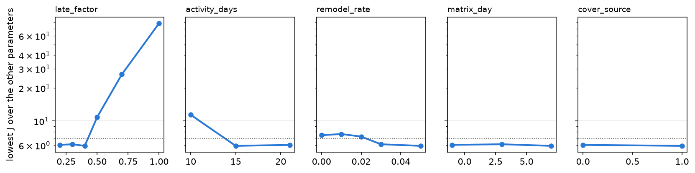
*Lowest J over the other parameters at each value of one parameter (coarse grid, seed 1); dotted line: best J + 1.*

### Results of the fitted model (setting A, 5 seeds, mean ± SD)
| Day | Third | Hong 2014 | Fitted, section | Fitted, volume | Fitted FCT, section |
|---|---|---|---|---|---|
| 14 | apical | 37.0 | 39.5 ± 0.4 | 55.7 ± 0.2 | 60.5 ± 0.4 |
| 14 | middle | 27.7 | 24.5 ± 1.4 | 41.9 ± 0.2 | 75.5 ± 1.4 |
| 14 | coronal | 19.6 | 19.9 ± 0.6 | 34.1 ± 0.1 | 80.1 ± 0.6 |
| 14 | **total** | 26.0 ± 2.9 | 26.0 ± 0.5 | 40.0 ± 0.1 | 74.0 ± 0.5 |
| 28 | apical | 46.6 | 62.0 ± 1.6 | 77.4 ± 0.7 | 38.0 ± 1.6 |
| 28 | middle | 46.8 | 45.3 ± 1.5 | 65.0 ± 0.5 | 54.7 ± 1.5 |
| 28 | coronal | 49.0 | 36.1 ± 0.7 | 55.2 ± 0.2 | 63.9 ± 0.7 |
| 28 | **total** | 47.7 ± 3.6 | 45.2 ± 0.7 | 61.9 ± 0.2 | 54.8 ± 0.7 |
| 56 | apical | 61.6 | 79.9 ± 2.0 | 85.1 ± 0.5 | 20.1 ± 2.0 |
| 56 | middle | 60.5 | 71.6 ± 1.4 | 80.9 ± 0.4 | 28.4 ± 1.4 |
| 56 | coronal | 62.5 | 58.1 ± 1.4 | 74.7 ± 0.1 | 41.9 ± 1.4 |
| 56 | **total** | 62.0 ± 17.1 | 67.8 ± 0.5 | 78.4 ± 0.1 | 32.2 ± 0.5 |

J = 6.5 ± 0.2 over 5 seeds (totals 0.6, thirds 5.9). For comparison: milestone-1 biology-only (upstream biology) 9.4, milestone-1 baseline (upstream mechanics at 300 µε) 94.8.
- **The totals now sit within Hong's SDs:** 26.0 / 45.2 / 67.8 against 26.0 / 47.7 / 62.0 (z = 0.0, −0.7, +0.3). No cartilage forms.
- **The thirds keep an apical-to-coronal gradient after week 2.** At week 4 the model has 62 / 45 / 36 against 47 / 47 / 49; at week 8 it has 80 / 72 / 58 against 62 / 60 / 63. None of the tested rules removed it without spoiling week 2 or the totals (above).
  - Possible causes: a coronal supply that starts after week 2 (the periosteum of the flap); a cap on how much of a region woven bone can fill (vascular and marrow spaces); or simply the uncertainty of Hong's thirds (2 dogs at week 4, no SD, read from a figure).
  - None of these was added. Each needs another parameter that the data cannot pin.
- **The volume** has 10-17 points more bone than the section, as in milestone 1.

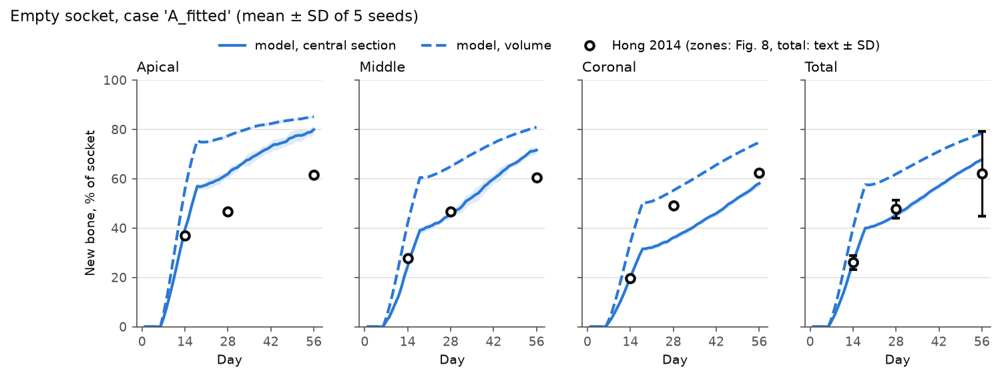
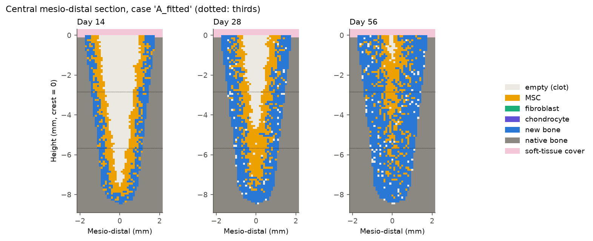

### Setting B: mechanics back on, cells sense the soft-tissue phase
Fitted biology from A, far-field load on the block, 3 seeds (section and volume totals, % new bone):

| Stimulus | Load | NB section, d14 / d28 / d56 | NB volume, d14 / d28 / d56 |
|---|---|---|---|
| none (A, biology-only, 5 seeds) | – | 26.0 / 45.2 / 67.8 | 40.0 / 61.9 / 78.4 |
| soft phase, no lower window | 150 µε | 26.1 / 45.1 / 68.0 | 40.0 / 61.9 / 78.3 |
| soft phase, no lower window | 300 µε | 26.1 / 45.1 / 68.0 | 40.0 / 61.9 / 78.3 |
| soft phase, no lower window | 1000 µε | 26.1 / 45.1 / 68.0 | 40.0 / 61.9 / 78.3 |
| soft phase, with lower window | 150 µε | 2.8 / 1.0 / 1.0 | 7.8 / 3.8 / 3.1 |
| soft phase, with lower window | 300 µε | 14.2 / 11.6 / 23.7 | 29.3 / 26.8 / 37.2 |
| soft phase, with lower window | 1000 µε | 19.5 / 38.6 / 65.0 | 36.4 / 59.6 / 77.3 |
| element average (upstream), with window | 300 µε | 19.0 / 17.2 / 17.9 | 27.3 / 23.4 / 16.1 |

- **Soft phase without the lower window reproduces the calibrated result at all three loads.** Every element keeps the bone stimulus for 56 days, and the runs are bit-identical to the biology-only runs with the same seeds (statistics compared). The soft tissue's pressure stays tiny (median |HP| 6 × 10⁻⁶ to 4 × 10⁻⁵ MPa against the 0.15 MPa limit). Its strain equals the imposed far-field strain once the socket has stiffened. The largest element strain in any of these runs is 2.3 % (day 7, 1000 µε), under the 5 % limit. Mechanics stays in the model: the upper limits (5 % strain, 0.15 MPa) are those an implant gap's micromotion will meet.
- **With the lower window it fails at physiological loads.** As the socket fills, its strain falls to the far-field strain. At 150 and 300 µε that is below the 400 µε limit, so elements fall into the resorption window, and osteoblasts die at 16 % a day there.
  - At 150 µε bone is almost absent (69 % of the elements are in the window at day 56).
  - At 300 µε bone oscillates (14 → 12 → 24 % on the section): forming bone stiffens the socket and lowers its strain, which resorbs the bone, which raises the strain again.
  - At 1000 µε the result is close to A (65 vs 68 % at day 56). Only a few strain-shielded elements dip below the limit between days 10 and 28.

  A habitual jaw strain below 400 µε would then make healthy bone "resorb". The upstream lower limit (chosen for a sheep tibia under walking load) is inconsistent with the assumed jaw strains. We recommend dropping it for the socket (Claes & Heigele 1999 have no lower limit) and modelling disuse resorption of the ridge separately when that is needed.
- **The upstream element-average stimulus** still caps the socket at 300 µε (18 % section, 16 % volume at day 56; 416 of 521 elements fibrous) even with the fitted biology: the milestone-1 finding.

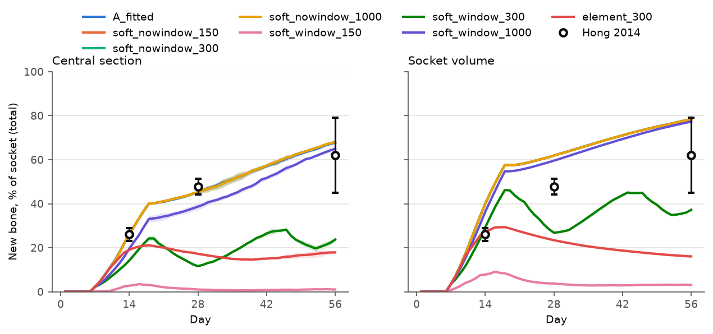
*Totals of the B runs. The three soft-phase runs without the lower window lie on the A curve.*

**Recommended dental setting:** `stimulus_mode 1`, `lower_window 0`, `activity_days 18`, `late_factor 0.25`, `remodel_rate 0.03` (from day 14), wall seeding 30 % over 0.2 mm, no clot entry, no cover source, far-field load as the scenario requires.

### Run times (phoenix, 15 runs in parallel, one CalculiX thread each)
| Stage | Runs | Wall time | Per run |
|---|---|---|---|
| Coarse grid (biology-only, no FE, sparse output) | 540 | 162 s | 4.4 s |
| Refinement | 240 | 72 s | 4.4 s |
| Candidates × 5 seeds | 50 | 16 s | 4.3 s |
| Local identifiability (13 points × 5 seeds) | 65 | 20 s | 4.2 s |
| Fitted (5 seeds, daily lattice) + setting B (21 runs with FE) | 26 | 69 s | 30.5 s mean |

All milestone-2 runs used one build of commit 19b8224 (its `build_info.txt` says `e6be8b4+fix`: the same source, built just before it was committed). A first grid with remodelling before differentiation hung in 5 of 540 runs: removing osteoblasts left fewer eligible MSCs than the precomputed target. Remodelling now acts after differentiation, and the differentiation target is capped at the MSCs still eligible. The defaults stay bit-identical to milestone 1 (checked). The whole grid was rerun on the fixed code.

### Decisions needed before the β-TCP arm
1. **Accept the recommended setting** (soft-phase stimulus without the lower window). Then the empty-socket result does not depend on the jaw load, which seems right for a closed, unloaded socket, and mechanics acts only through the upper limits. The alternative is to keep a lower window scaled below the habitual jaw strain; that needs a jaw-strain value we do not have.
2. **Remodelling:** keep 0.03 /day, knowing that Hong's data cannot pin it, or fix it from another source (woven-bone turnover in dog sockets, e.g. Cardaropoli 2003's later time points).
3. **The remaining gradient in the thirds:** accept it, or test one more rule (a delayed coronal source or a cap on local bone fraction) against data with SDs for the thirds (Hong's Table S1, in the online supplement).
4. **β-TCP granules:**
   - lattice representation (explicit spheres of 500-1000 µm as an occupied, guiding code like the upstream scaffold's 12);
   - initial solid fraction (Cerasorb variant: about 0.2 or 0.42; Hong's 38 % residual at 2 weeks needs the denser one or a granule-envelope measurement);
   - resorption (k = 0.031 /day from Hong's residual graft; the next step will check it per third against Fig. 8);
   - and whether β-TCP gets the upstream "TCP stimulation" (activity / 2 instead of / 5 after the active phase). Hong's β-TCP sockets had *less* bone at 2-4 weeks, so a stimulation is not supported for this arm.
5. **Which β-TCP outputs to fit:** new bone and residual graft per third at 2/4/8 weeks (digitized, [data/hong2014_btcp.csv](data/hong2014_btcp.csv)). The only free parameters would be the granule-related ones; the biology stays as fitted here.

## Milestone 3: the β-TCP arm

### Set-up (coordinator's decisions, 2026-11-16, delegated by Melih)
- **Biology:** milestone 2's calibrated setting, unchanged: activity 18 days, late factor 0.25, remodelling 0.03 /day (still unidentified). The cells sense the soft-tissue phase, with no lower window. The fitting runs force the bone stimulus, which milestone 2 showed is identical; this is checked again below with granules.
- **Granules:** explicit spheres, random-packed, 500-1000 µm, lattice code 12 (solid, guiding migration and deposition), each shrinking as it resorbs. In the FE mixture they count as β-TCP (3.5 GPa) while present. Details: [../README.md](../README.md#β-tcp-granules-srcgranulescpp).
- **Initial granule envelope fraction:** 0.42, since Hong's RB is the histological granule area; 0.2 is run as a sensitivity case.
- **Resorption:** start from k = 0.031 /day (Hong's RB 38.3 → 10.3 %), check it per third, and fit it only if needed.
- **TCP stimulation:** none by default (Hong saw *less* early bone with β-TCP); upstream's stimulation runs as a variant.
- **Targets:** Hong's β-TCP NB and RB, totals and thirds, at 2, 4 and 8 weeks, on the central section ([data/hong2014_btcp.csv](data/hong2014_btcp.csv)).
- **Objective:** as in milestone 2, with the RB terms added the same way. RB is weighted by its own SDs (2.35, 15.25, 4.14), and the thirds by 1/6.

### What the first runs showed, and the one rule added
With the milestone-2 biology and guiding granules, the grafted socket heals like an empty one: NB 25 / 48 / 69 % against Hong's 5 / 11 / 49 % (run `V_nodelay` below). The granules even add surfaces for bone to start on. Hong found the opposite, and concluded that the grafts "delay rather than arrest" bone formation, through a stronger early inflammatory reaction. Their osteoclast-like cell counts are highest at 2 weeks (1049 per section, against 1 in empty sockets).

We added that as one rule, `tcp_delay`. In a grafted socket the cells wait `tcp_delay` days: no proliferation, migration or differentiation. Then their own clock starts (differentiation from its day 6, remodelling from its day 14). Two ways of starting were compared:
- `tcp_delay_activity 1`: the whole high-activity period starts late. Best J 26-28 at an 18-20-day delay, with bone overshooting at 8 weeks (61-62 %).
- `tcp_delay_activity 0`: the high-activity period still ends on the real day 18, so the delayed cells start with the late rates. The early burst of activity is spent on the inflammatory phase. Best J 18 at a 12-day delay.

The second is the fitted rule. Delaying only differentiation while cells keep multiplying makes it worse (week 4: 59 % bone): the waiting cells fill the clot, and bone then forms everywhere at once.

### Search
| Stage | Runs | What varied | Wall time |
|---|---|---|---|
| Grid (activity period shifted with the delay) | 864 = 288 sets × 3 seeds | granule fraction 0.42/0.2, TCP stimulation × 1/× 2.5, delay 12-22 d, lag 6-12 d, k 0.025/0.031/0.037 | 258 s (4.5 s per run) |
| Variant scan (activity on the real clock) | 21 | delay 4-16 d, lag 10, k 0.031, 3 seeds | 8 s |
| Refinement | 145 = 29 sets × 5 seeds | delay 10-14, lag 8-12 at k 0.031; k 0.025-0.037 at delay 12, lag 10 | 41 s |
| Final | 34 | fitted point and 4 variants × 5 seeds (daily output); soft-phase stimulus at 150/300/1000 µε × 3 seeds (FE on) | 43 s (12.4 s per run) |

All on phoenix, 15 runs in parallel, one CalculiX thread each. The grid used the build of commit a6eab60; the later stages used commit 2df6bf4, which only adds `tcp_delay_activity` (default 1 = the grid's behaviour). Both builds reproduce milestones 1 and 2 bit for bit (checked).

### Fitted granule parameters
| Parameter | Value | How it was set | Identifiability |
|---|---|---|---|
| `granule_fraction` | 0.42 | decision (granule envelope) | 0.2 cannot reach Hong's RB (15 / 10 / 4 % against 38 / 26 / 10; J 167) |
| `tcp_k` | 0.031 /day | from Hong's RB totals, kept | not needed: J is flat over 0.025-0.037 (17.9-19.3 ± 9-16, 5 seeds) |
| `tcp_lag` (resorption onset) | 10 days | fitted | 8-11 days fit equally (J 17.9-18.8), 12 is worse (20.8) |
| `tcp_delay` | 12 days | fitted | identified: 11-13 days J 17.9-18.2, 10 and 14 J 21.2 and 19.1, 8 and 16 J 34 and 29 |
| `tcp_delay_activity` | 0 (real clock) | rule comparison | J 18 vs 26 for the shifted period |
| `tcp_late_mult` (TCP stimulation) | 1 (none) | decision, tested | × 2.5 overshoots (NB 83 % at 8 weeks, J 75) |

So Hong's β-TCP arm pins the delay of bone formation (about 12 days) and confirms the resorption kinetics: onset about 10 days, then k ≈ 0.031 /day. It cannot separate k from the onset within 0.025-0.037 and 8-11 days.

### Results of the fitted model (5 seeds, mean ± SD; section as Hong measured)
| Day | Third | Hong NB | Model NB, section | Model NB, volume | Hong RB | Model RB, section | Model RB, volume |
|---|---|---|---|---|---|---|---|
| 14 | apical | 10.6 | 0.0 ± 0.0 | 0.0 | 36.8 | 36.9 ± 5.7 | 35.9 |
| 14 | middle | 3.6 | 0.0 ± 0.0 | 0.0 | 42.1 | 39.8 ± 9.6 | 38.0 |
| 14 | coronal | 2.5 | 0.0 ± 0.0 | 0.0 | 36.3 | 38.4 ± 7.5 | 38.2 |
| 14 | **total** | 5.0 ± 3.0 | 0.0 ± 0.0 | 0.0 | 38.3 ± 2.4 | 38.5 ± 6.5 | 37.8 |
| 28 | apical | 13.8 | 15.5 ± 2.0 | 18.6 | 34.9 | 24.4 ± 2.7 | 23.9 |
| 28 | middle | 10.1 | 9.4 ± 1.5 | 14.8 | 25.3 | 25.9 ± 8.2 | 25.0 |
| 28 | coronal | 9.7 | 7.2 ± 1.7 | 11.9 | 21.2 | 25.4 ± 6.0 | 25.2 |
| 28 | **total** | 11.1 ± 6.3 | 9.9 ± 1.4 | 13.9 | 25.8 ± 15.2 | 25.3 ± 5.3 | 25.0 |
| 56 | apical | 47.1 | 56.1 ± 4.8 | 61.2 | 10.6 | 10.4 ± 2.1 | 10.5 |
| 56 | middle | 48.0 | 53.2 ± 1.2 | 58.2 | 14.2 | 10.0 ± 3.0 | 10.7 |
| 56 | coronal | 48.6 | 43.5 ± 4.7 | 53.1 | 8.1 | 10.3 ± 4.0 | 11.1 |
| 56 | **total** | 48.5 ± 5.9 | 49.8 ± 3.0 | 56.1 | 10.3 ± 4.1 | 10.2 ± 2.1 | 10.9 |

J = 18.1 ± 14.7 over 5 seeds (totals 9.5, thirds 8.6); the seed-to-seed spread comes mostly from where granules cut the single section.
- **The totals match** at weeks 4 and 8 for new bone, and at all three weeks for residual graft (z within ±0.4).
- **New bone at 2 weeks is 0** against Hong's 5 ± 3 % (10.6 % apically). The delay holds back all early bone, while Hong shows a little woven bone along the apical walls. A partial delay (cells at the wall not delayed) might fix this; it was not added.
- **Residual graft per third:** the model resorbs evenly. Hong keeps more graft apically at 4 weeks (35 vs 21 % coronally), but with an SD of 15 on the total at that week this is weak evidence. No location-dependent resorption was added.
- **New bone per third at 8 weeks** keeps the gradient of the empty socket (56 / 53 / 44 vs Hong's even 47 / 48 / 49).

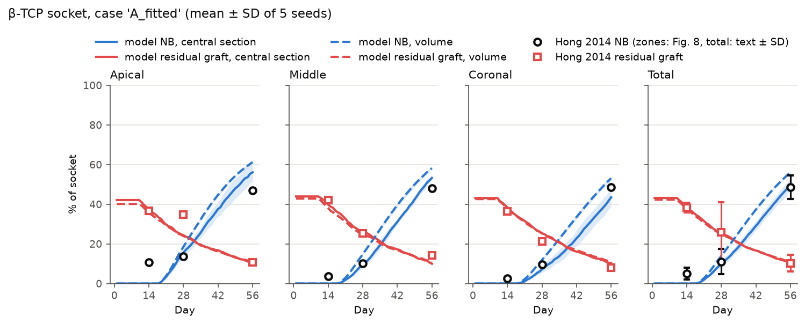
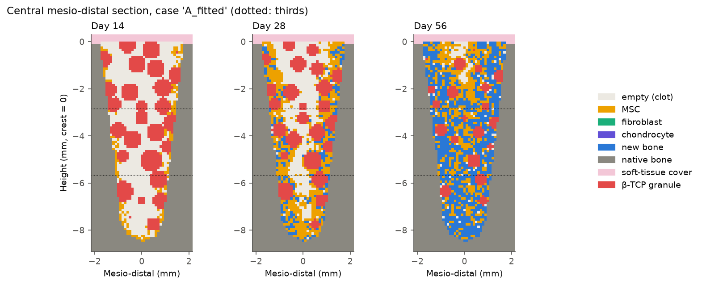

### Variants (5 seeds; B: 3 seeds)
| Case | NB section, d14 / d28 / d56 | RB section, d14 / d28 / d56 | J |
|---|---|---|---|
| Hong 2014 | 5.0 / 11.1 / 48.6 | 38.3 / 25.8 / 10.3 | – |
| **Fitted** (delay 12 d, real-clock activity) | 0.0 / 9.9 / 49.8 | 38.5 / 25.3 / 10.2 | 18.1 |
| No delay (milestone-2 biology + guiding granules) | 24.5 / 48.0 / 69.2 | 38.5 / 25.3 / 10.2 | 151 |
| Upstream TCP stimulation (late factor × 2.5) | 0.0 / 24.3 / 82.8 | 38.5 / 25.3 / 10.2 | 75 |
| Activity period shifted with the delay (delay 18 d) | 0.0 / 10.0 / 62.2 | 38.5 / 25.3 / 10.2 | 26 |
| Granule fraction 0.2 | 0.0 / 8.5 / 43.2 | 15.2 / 9.6 / 4.1 | 167 |
| Soft-phase stimulus, 150 / 300 / 1000 µε (3 seeds) | 0.0 / 10.7 / 51.8 | 36.2 / 23.6 / 10.1 | 22.4 |

- **Mechanics back on:** with the soft-tissue-phase stimulus and no lower window, the cells behave bit for bit as in the forced-bone runs at all three loads (statistics compared, seeds 1-3). The B row differs from the fitted row only because it averages 3 seeds instead of 5. The granules stiffen the socket, and the largest element strain is 0.8 % at 1000 µε, far below the 5 % limit.
- **TCP stimulation** is rejected by Hong's data, as expected from their finding that β-TCP slows early bone.

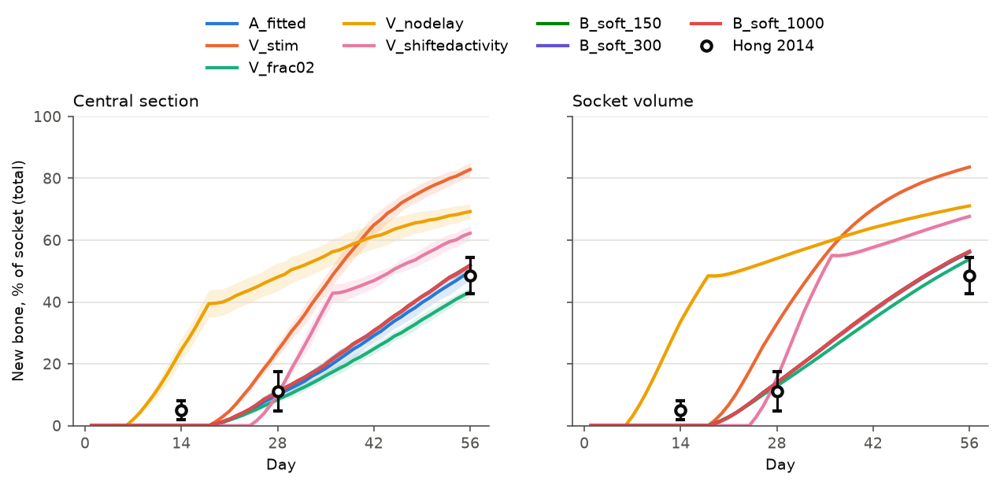
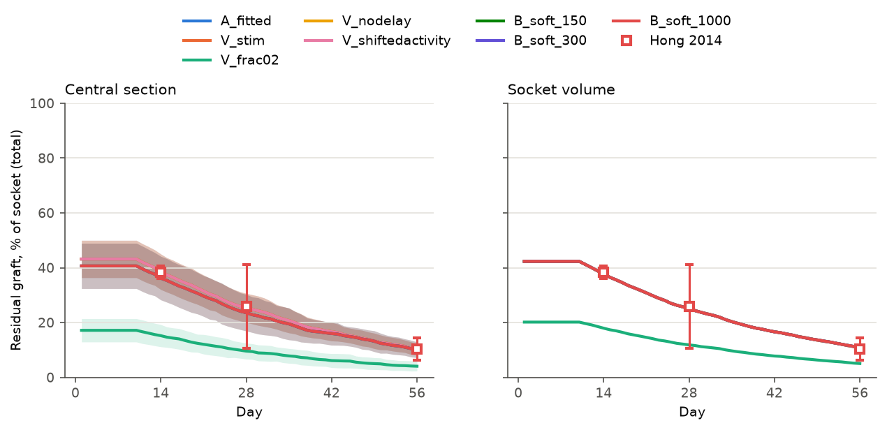

### Open issues
1. **The delay is phenomenological:** one number (12 days) for the graft's inflammatory phase. The literature agent's findings on whether and how much β-TCP delays early bone in dog sockets should test it. If they support a mechanism (e.g. osteoclast-covered granule surfaces that are not osteoconductive early), `tcp_guide_day` or `tcp_diff_mult` / `tcp_inhibit_days` can replace or refine it; both are already runtime parameters.
2. **No early bone at 2 weeks** (0 vs 5 %); see above.
3. **Resorption** is uniform and time-driven, not cell-driven, and the onset and k trade off. Hong's per-third RB and the osteoclast counts per third (Fig. 9) could support a cell-driven rule later.
4. **The thirds' gradient** of the empty socket carries over. Remodelling (0.03 /day) is still unidentified.
5. **Packing:** granules are packed by random sequential addition with 10 % overlap allowed, not settled by gravity or condensed. They take part of the wall lining (fewer seeded MSCs), which partly stands in for the graft covering the wall.
6. **The single central section is noisy for RB** (SD 5-10 points between packings at 2-4 weeks, against 0.1-2 in the volume). Hong's SDs come from 2 dogs at weeks 2 and 4.
7. **The 0.42 envelope is a decision.** If the literature agent finds a packing density for Cerasorb in a socket, that is a one-number change.

## Reproduce
On a Linux machine with CalculiX, gmsh, meshio, numpy, matplotlib and g++ (the runs here used hwpool lease 56ea on phoenix: Ubuntu, ccx 2.21 from apt, gmsh 4.15.2 from pip):

```bash
cd dental
python3 geometry/socket_geometry.py --out ~/sg/meshes/m08
python3 geometry/socket_geometry.py --socket-size 0.6 --out ~/sg/meshes/m06
tools/run_hong_m1.sh ~/sg/meshes/m08 ~/sg/runs_m1                       # 11 runs in parallel
tools/run_hong_m1_checks.sh ~/sg/meshes/m08 ~/sg/meshes/m06 ~/sg/runs_m1_checks
R=~/sg/runs_m1
python3 tools/analyze_socket.py --out ~/sg/ana_m1 --hong hong/data/hong2014_empty_socket.csv \
  --case baseline=$R/baseline_s1,$R/baseline_s2,$R/baseline_s3 \
  --case biology_only=$R/biology_only_s1,$R/biology_only_s2,$R/biology_only_s3 \
  --case zero_load=$R/zero_load --case load_150=$R/load_150 --case load_1000=$R/load_1000 \
  --case upstream_counting=$R/upstream_counting --case claes_sign=$R/claes_sign \
  --maps baseline --maps biology_only --maps claes_sign
```

Run times on phoenix (16 threads, one CalculiX thread per run): meshing under a second; one 56-day run 26 s and 120 MB (0.8 mm mesh) or 38 s and 160 MB (0.6 mm); the 11-run batch about 2 minutes including compilation. Times per run are in `results/m1/timing*.csv`.

Milestone 2 (on a lease with the mesh in `~/sg/meshes/m08`):

```bash
cd ~/sg && dental/tools/prepare_run.sh meshes/m08 m2/build          # one build; parameters are runtime
cd m2 && T=../dental/tools && H=../dental/hong/data/hong2014_empty_socket.csv
python3 $T/make_sets_m2.py grid > grid.csv && python3 $T/run_sets.py --build build --sets grid.csv --out grid
python3 $T/score_hong.py --hong $H --out grid_scores.csv grid && python3 $T/identifiability.py profile grid_scores.csv ana_grid
python3 $T/make_sets_m2.py refine > refine.csv && python3 $T/run_sets.py --build build --sets refine.csv --out refine
python3 $T/score_hong.py --hong $H --out refine_scores.csv refine
python3 $T/candidates_m2.py grid_scores.csv refine_scores.csv > cand.csv && python3 $T/run_sets.py --build build --sets cand.csv --out cand
python3 $T/make_sets_m2.py local fitted_params.json > local.csv && python3 $T/run_sets.py --build build --sets local.csv --out local
python3 $T/score_hong.py --hong $H --out local_scores.csv local && python3 $T/identifiability.py local local_scores.csv ana_local
python3 $T/make_sets_m2.py final fitted_params.json > final.csv && python3 $T/run_sets.py --build build --sets final.csv --out final
```
then the tables and figures:

```bash
F=final; s3(){ echo $F/$1_s1,$F/$1_s2,$F/$1_s3; }
python3 $T/analyze_socket.py --out ana_final --hong $H \
 --case A_fitted=$F/A_fitted_s1,$F/A_fitted_s2,$F/A_fitted_s3,$F/A_fitted_s4,$F/A_fitted_s5 \
 --case soft_nowindow_150=$(s3 B_soft_lw0_150) --case soft_nowindow_300=$(s3 B_soft_lw0_300) --case soft_nowindow_1000=$(s3 B_soft_lw0_1000) \
 --case soft_window_150=$(s3 B_soft_lw1_150) --case soft_window_300=$(s3 B_soft_lw1_300) --case soft_window_1000=$(s3 B_soft_lw1_1000) \
 --case element_300=$(s3 B_elem_lw1_300) --maps A_fitted --maps soft_window_150 --maps soft_window_300 --maps element_300
```
`live_panel.py --root m2 --hong $H` (on the lease display, `on-desktop -d`) replays finished runs day by day.

Milestone 3 (lease, mesh `meshes/m08`, build in `m3/build`, `H=../dental/hong/data/hong2014_btcp.csv`):

```bash
python3 $T/make_sets_m3.py grid > grid3.csv && python3 $T/run_sets.py --build build --sets grid3.csv --out grid
python3 $T/score_hong.py --hong $H --out grid_scores.csv grid && python3 $T/aggregate_seeds.py grid_scores.csv grid_agg.csv
python3 $T/run_sets.py --build build --sets var3.csv --out var          # results/m3/sets/var3.csv
python3 $T/run_sets.py --build build --sets refine3.csv --out refine    # results/m3/sets/refine3.csv
python3 $T/make_sets_m3.py final fitted_params.json > final3.csv && python3 $T/run_sets.py --build build --sets final3.csv --out final
```
then the tables and figures:

```bash
F=final; s5(){ echo $F/$1_s1,$F/$1_s2,$F/$1_s3,$F/$1_s4,$F/$1_s5; }; s3(){ echo $F/$1_s1,$F/$1_s2,$F/$1_s3; }
python3 $T/analyze_socket.py --out ana_final --hong $H --case A_fitted=$(s5 A_fitted) --case V_stim=$(s5 V_stim) \
 --case V_frac02=$(s5 V_frac02) --case V_nodelay=$(s5 V_nodelay) --case V_shiftedactivity=$(s5 V_shiftedactivity) \
 --case B_soft_150=$(s3 B_soft_150) --case B_soft_300=$(s3 B_soft_300) --case B_soft_1000=$(s3 B_soft_1000) \
 --maps A_fitted --maps V_nodelay --maps V_frac02
```

## Files
- Milestone 3, `results/m3/`:
  - `fitted_params.json`, `build_info.txt`
  - `grid/`, `variant_scan/`, `refine/` (scores and seed averages), `sets/` (parameter CSVs)
  - `final_analysis/` (tables, figures, scores)
  - `final_runs/<run>/`: statistics, zones, mechanics, parameters, `granules.csv`, logs; `section_daily.bin` for `A_fitted_s1`
- Milestone 2, `results/m2/`:
  - `fitted_params.json`, `build_info.txt`
  - `grid/` (sets, scores, profiles, sub-models), `refine/`, `candidates/`, `local/` (scores and `local_identifiability.json`), `sets/` (the parameter CSVs)
  - `final_analysis/` (tables, figures, `final_scores.csv`)
  - `final_runs/<run>/`: statistics, zones, mechanics, parameters, logs; `section_daily.bin` for two runs
- `data/`: Hong 2014 reference values (empty and β-TCP).
- Milestone 1:
  - `results/m1/analysis/`: `summary.csv` (case means and SDs at days 14 / 28 / 56), `daily.csv` (every run, day, region and third), `comparison.md` (tables for every case), figures.
  - `results/m1/analysis_mesh_check/`: the 0.6 vs 0.8 mm comparison.
  - `results/m1/runs/<case>/`: per-run `statistics.csv`, `mechanics.csv`, upstream counters, `build_info.txt`, `log.txt`, `time.txt`.
  - `results/m1/mesh/`: mesh summaries and `model_info.h` of both meshes.

The daily lattices (`lattice_<it>.raw`, 170 kB each) were not kept: every run can be reproduced bit-identically from its seed and flags.
